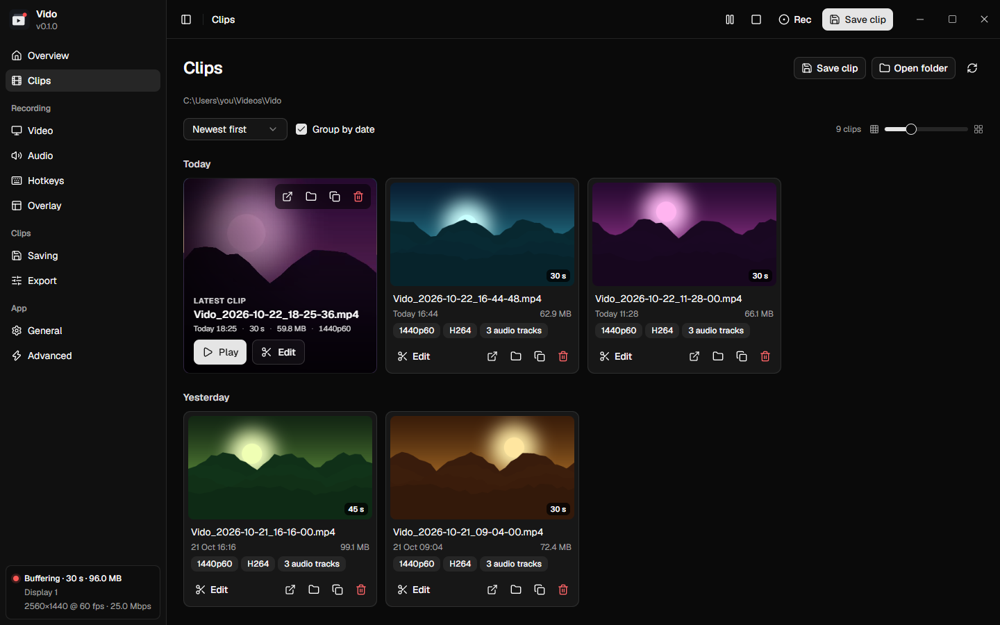
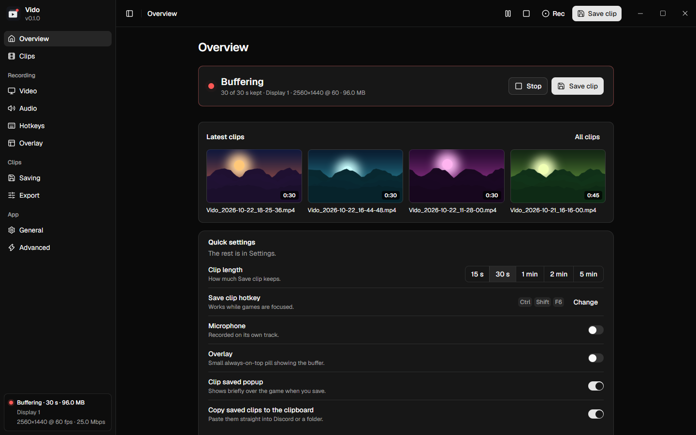
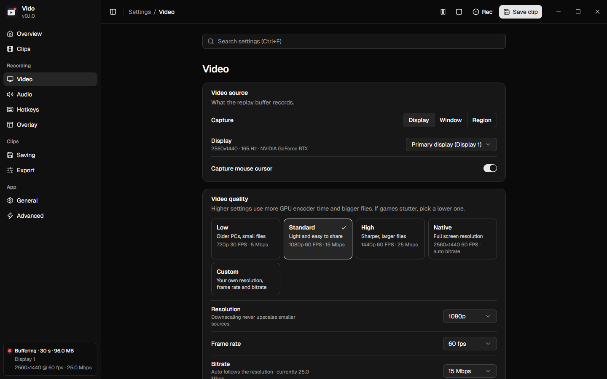
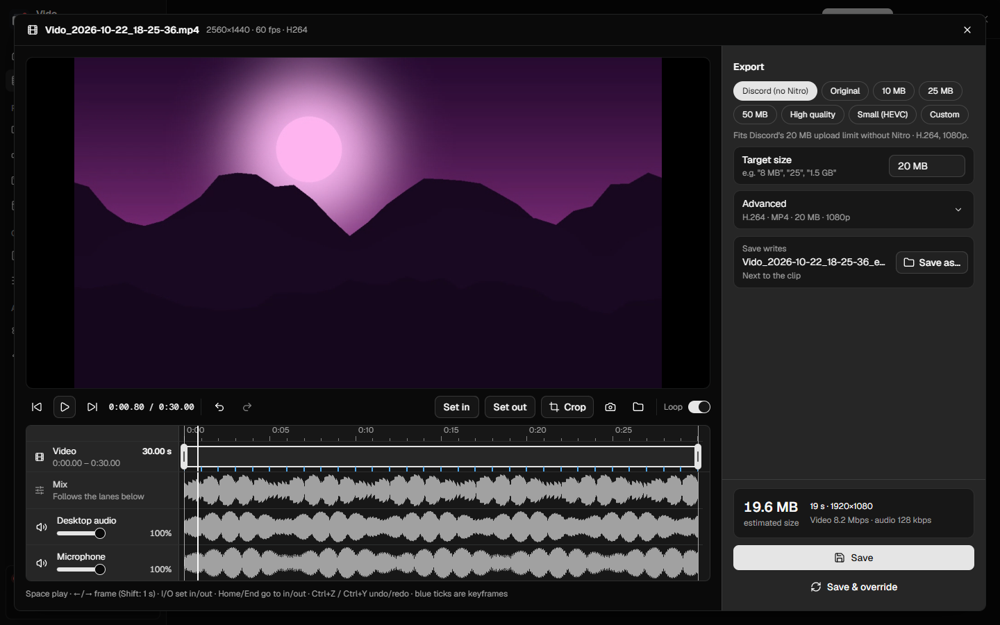
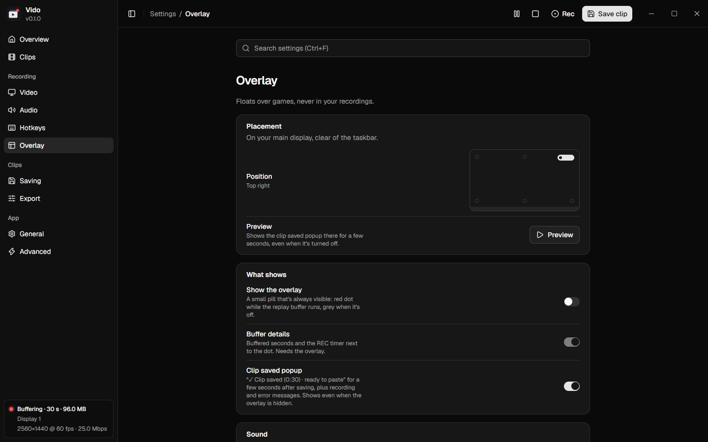
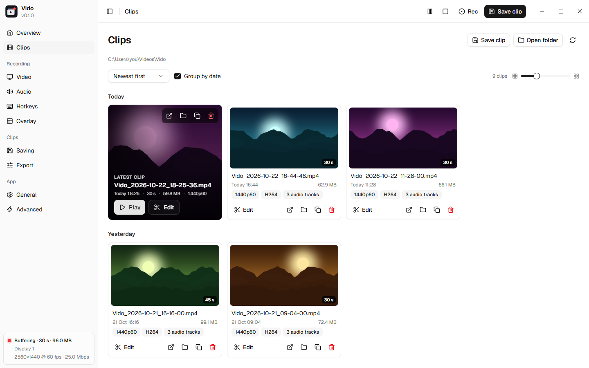

# Vido

**Clip the last 30 seconds of your game with one key.** Vido is a lightweight replay-buffer
clipper for Windows, like the big clipping apps, but **without the account, cloud, ads,
watermark or telemetry**. Everything stays on your PC.

> **Heads-up:** Vido is mostly AI-generated: most of its code and docs were written with an AI
> coding assistant, then directed, tested and reviewed by a human. Expect rough edges, and please
> report anything that breaks.

- **Always ready:** Vido keeps the last moments of your screen and audio in memory. Press your
  hotkey and the clip is saved in milliseconds, with no re-encoding.
- **Paste it anywhere:** a saved clip is copied to the clipboard, so you can **Ctrl+V** it straight
  into Discord or a folder.
- **Quick edits:** trim, crop, blur private details, make a vertical 9:16 version, mute or turn
  down individual audio tracks, and shrink clips to fit Discord's upload limit.
- **Lightweight:** about **30 MB of RAM** idling in the tray (closing the window unloads the UI
  completely), plus the buffer itself (roughly 50–200 MB for 30 s). Capture and encoding stay on
  your GPU (NVIDIA, AMD or Intel), so CPU use is tiny.
- **Private:** no accounts, uploads, telemetry, ads or watermarks. The only thing Vido ever
  sends is an update check to GitHub, which you can turn off.

https://github.com/user-attachments/assets/1fb14899-bd96-4b93-a78a-c034d1d5489b

---

## Vido vs. Bloated Competitor

|                                         | **Vido**                                  | **Bloated Competitor**      |
| --------------------------------------- | ----------------------------------------- | --------------------------- |
| Account needed                          | No                                        | Yes, to use the app         |
| Works fully offline                     | Yes                                       | No                          |
| Clips uploaded to a cloud / social feed | Never                                     | Built in                    |
| Telemetry and analytics                 | None                                      | Yes                         |
| Ads, upsells, premium tier              | None                                      | Yes                         |
| Open source                             | Yes (GPL-3.0)                             | No                          |
| Saving a clip                           | Instant remux, no re-encode               | Instant                     |
| Ctrl+V the video into Discord           | Yes, copied on save                       | Through its own share links |
| Fit Discord's free upload limit         | One-click "Discord (no Nitro)" preset     | Yes                         |
| Portable version (no install)           | Yes                                       | No                          |
| Multiple audio tracks                   | Every device on its own track, plus a mix | Mixed by default            |
| Per-track editing                       | Mute / volume per track, heard live       | Basic                       |
| Idle RAM                                | ~30 MB + buffer                           | Heavier (300mb-1gb)         |
| Overlay kept out of your clips          | Always (Windows capture exclusion)        | Not guaranteed              |
| Updates                                 | You choose (auto-install is opt-in)       | Forced, automatic           |
| Automatic game detection                | Yes                                       | Yes                         |

Vido is for people who want their clips on their own disk and nothing else. If you want a social
platform built around your clips, the competitor does more of that.

---

## Download & install

Get the latest version from **[Releases](https://github.com/LegendNed/Vido/releases/latest)**:

| Download                                                                                                      | What it is                                                                       |
| ------------------------------------------------------------------------------------------------------------- | -------------------------------------------------------------------------------- |
| **[Vido-setup.exe](https://github.com/LegendNed/Vido/releases/latest/download/Vido-setup.exe)**               | Installer. Per-user, no admin rights needed, adds a Start-menu entry.            |
| **[Vido-portable-x64.zip](https://github.com/LegendNed/Vido/releases/latest/download/Vido-portable-x64.zip)** | Portable. Unzip anywhere and run `vido.exe`; settings stay in the `data` folder. |

**Requirements**

- Windows 10 (1903 or newer) or Windows 11, 64-bit.
- Microsoft Edge WebView2 Runtime (already on Windows 11; the installer adds it if missing).
- A GPU with a hardware video encoder is recommended. Tested on NVIDIA (RTX 5090) and AMD
  hardware; Intel Quick Sync is supported but less tested. Without one, Vido falls back to the CPU.

Windows SmartScreen may warn about an unknown publisher on first launch: choose **More info →
Run anyway**.

---

## Getting started

1. **Run Vido.** A short setup asks which display to record, which audio to include, how long
   your clips should be and how good they should look (it suggests a quality for your PC).
2. **Play.** Vido sits in the tray (bottom-right of the taskbar) and keeps buffering. It starts
   with Windows by default; you can turn that off in Settings → General.
3. **Press Ctrl+Shift+F6** (or **Save clip** in the window or tray menu) when something happens.
   A small "Clip saved" popup appears over the game and the clip is ready to paste.
4. **Open Vido** from the tray to watch, edit or delete your clips.

Clips are saved to `Videos\Vido` (change it in Settings → Saving).

---

## What you can do

### Save clips

- **Sorted by game:** clips of anything Windows' Game Bar recognises as a game, or that Steam,
  Epic, GOG, EA app or Ubisoft Connect installed, go into a folder named after the game
  (everything else stays in the main folder), and the Clips page can filter by game.
- **Clip length** from 5 seconds to 10 minutes. Saving takes everything in the buffer.
- **Quality presets** (Low, Standard, High, Native, or your own resolution, frame rate and bitrate).
- Record a **display, a window** (found again after the game restarts) **or a region**.
- **Audio:** any number of speakers/headphones and microphones, each on its own track, plus a mix
  that plays everywhere. Optional noise suppression for microphones.
- **Re-encode on save** (optional): Vido saves instantly, then compresses the clip in the
  background (e.g. to 20 MB for Discord) and tells you when it's ready.
- **After saving:** copy the video (default) or its path, open the folder or editor, or run your
  own command.
- **Make it longer:** missed the end? Save again within 15 seconds and the second save replaces
  the first with one longer clip (can be turned off).
- **Only while a game runs** (optional): the buffer starts when a game does and stops a minute
  after it closes. Stop it by hand mid-game and it stays stopped until that game closes.
- **Manual recording** for longer sessions, and **pause** the buffer when you don't need it.

### Watch and edit

- A **Clips** library grouped by date, by game or not at all, with a resizable grid and a
  built-in player (←/→ to step through clips). **Search**, **favorites** and **rename** clips, or
  select several to favorite, export audio from, shrink or delete them together. **Drag a clip**
  straight into Discord, a folder or a browser upload box.
- The **editor** has a timeline with one lane per audio track: trim with the handles, mute or
  change the volume of each track (heard live), crop, take a PNG of the current frame, undo/redo.
- **Blur** names, chat or anything private: drag one or more boxes over it.
- **Quick formats:** **Phone (9:16)** for Shorts, TikTok and Reels (drag a 9:16 window, or fit
  the whole frame on a blurred background), or an animated **GIF** (15 fps, up to 480 px, at most
  30 s).
- **Speed** from 0.25× to 4× and **fade in / fade out** (to black and silence), previewed live.
- **Export audio tracks** as WAV files (one per track) from the editor or the clip menu.
- **Save** writes a copy next to the clip; **Save & override** replaces it (the original goes to
  the Recycle Bin).
- **Export presets:** **Discord (no Nitro)** (20 MB), Original (instant, lossless when you only
  trim), 10 / 25 / 50 MB, High quality, Small (HEVC), or anything under Advanced.

### Storage

The **Storage** page shows how full the drive is, which games' clips take the most space, and the
biggest clips (play, show in folder or delete). **Shrink old clips** re-encodes clips older than a
week, month or more to HEVC or H.264 at 1080p and replaces them (the originals go to the Recycle
Bin), skipping favorites and clips that are already small. It keeps running while you use the rest
of the app.

### Overlay and sound

- A **"Clip saved" popup** in the corner of your choice (on by default), and an optional
  always-visible buffer indicator. Both float over borderless and windowed games and never show
  up in your recordings.
- A soft **save sound** (Tap, Two-Tone, Bloop, Pluck or your own WAV) with its own volume.

### Updates

When a new version is out, an **Update** button appears in the top bar: it shows what's new and
installs the update in one click (Vido restarts by itself). Updates are signed, and Vido refuses
anything that doesn't match its signature. In Settings → General you can turn the check off, or
let Vido install updates automatically the next time it starts. The portable version updates
itself in place and keeps its `data` folder.

### Looks

Light and dark themes follow Windows. The sidebar can be full, icons only or hidden.

---

## Hotkeys

| Action                               | Default        |
| ------------------------------------ | -------------- |
| Save clip (everything in the buffer) | Ctrl+Shift+F6  |
| Start / stop manual recording        | Ctrl+Shift+F9  |
| Pause / resume the buffer            | Ctrl+Shift+F10 |
| Open the last clip                   | Ctrl+Shift+F11 |
| Open the editor (last clip)          | Ctrl+Shift+F12 |

Change them in Settings → Hotkeys. In the editor: **Space** play/pause, **←/→** previous/next
frame (Shift: 1 s), **I/O** set in/out, **Ctrl+Z / Ctrl+Y** undo/redo.

---

## Good to know

- **Exclusive fullscreen:** Windows can't capture true exclusive-fullscreen games, and the overlay
  can't appear over them. Most modern games work fine; if your clips are black, switch the game
  to **borderless** or **windowed**. The save sound still plays.
- **Games running as administrator** only receive hotkeys from programs that also run as
  administrator. Run Vido as administrator in that case.
- **Microphone:** allow desktop apps under _Windows Settings → Privacy & security → Microphone_.
- **HDR** screens are recorded as SDR.
- **Low disk space:** with less than 10 GB free on the clips (or buffer) drive, the buffer stops
  and won't start until there's more room, so a full disk never breaks a save.
- **Disk buffer:** keeping the buffer on disk instead of RAM writes constantly and wears out
  SSDs; Vido asks before you turn it on.

---

## Documentation

- [Building from source](docs/BUILDING.md): prerequisites, scripts, tests, installer and portable builds.
- [How it works](docs/HOW-IT-WORKS.md): the replay buffer, saving, Windows APIs and permissions.
- [Settings & files](docs/SETTINGS.md): where Vido keeps settings, logs and caches, hotkey rules.
- [Architecture](docs/ARCHITECTURE.md): threads, capture session, export pipeline, IPC.
- [Known limitations](docs/HOW-IT-WORKS.md#known-limitations).
- [Trailer](trailer/README.md): the 60-second video above and the scripts that render it.

## License

Vido is licensed under the **GNU GPL v3.0 or later** (see [LICENSE](LICENSE)). It uses FFmpeg's
GPL build; see [THIRD_PARTY_NOTICES.md](THIRD_PARTY_NOTICES.md).
