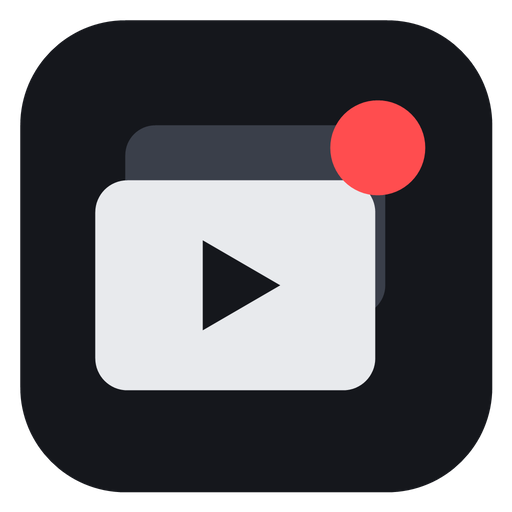

# Vido

**Clip the moment you just played.**

Vido keeps the last 30 seconds of your game in memory. Press one key and the clip is saved
instantly, already on your clipboard. No account, no cloud, no ads.

**[Download for Windows](https://github.com/LegendNed/Vido/releases/latest/download/Vido-setup.exe)**
· [Portable zip](https://github.com/LegendNed/Vido/releases/latest/download/Vido-portable-x64.zip)
· [Website](https://vido.rip)
· [Features](#features)
· [Compare](#vido-vs-bloated-competitor)
· [FAQ](#faq)
· [Docs](#documentation)
· [Report a bug](https://github.com/LegendNed/Vido/issues)

https://github.com/user-attachments/assets/1fb14899-bd96-4b93-a78a-c034d1d5489b

> **Heads-up:** Vido is mostly AI-generated: most of its code and docs were written with an AI
> coding assistant, then directed, tested and reviewed by a human. Expect rough edges, and please
> report anything that breaks.

## Built to stay out of your way

|            |                                                                     |
| :--------: | ------------------------------------------------------------------- |
| **~30 MB** | RAM while idling in the tray, with the UI fully unloaded            |
|  **GPU**   | Capture and encoding on NVIDIA, AMD or Intel, so CPU use stays tiny |
|  **0 ms**  | Re-encoding when you save: the buffer is copied straight to disk    |
|   **0**    | Accounts, uploads, ads, watermarks or telemetry                     |

The only thing Vido ever sends is an update check to GitHub, which you can turn off.

## Features

Instant saves, a real editor and sensible defaults, in an app that never asks you to sign in.

### Missed the ending? Just save again.

Press save within 15 seconds and both saves become one longer clip. The short one goes to the
Recycle Bin, so there's nothing to stitch together. _Only in Vido._

### Discord-sized, automatically

Turn on **Re-encode on save** and Vido saves instantly, compresses in the background, and only
pings you when the small file is ready to paste.

- Presets for Discord's 10 / 20 / 25 / 50 MB limits
- Hardware encoding on your GPU
- The big original never shows up in your folder

### Every device on its own track

Game audio, voice chat and your mic are recorded separately, plus a mix that plays everywhere.
Mute your mic after the fact and hear the change live.

- Volume and mute per track, previewed live
- Export every track as WAV
- Optional noise suppression for mics

### Hide names and chat in two drags

Drop blur boxes over usernames, chat or anything private. You see the blur live, and it's burned
into the export.

### Phone-ready. GIF-ready. One click.

**Quick formats:** 9:16 for Shorts, TikTok and Reels (drag a vertical window, or fit the whole
frame on a soft blurred background), or turn the moment into a GIF (15 fps, up to 480 px, at most
30 s).

- Speed from 0.25× to 4×, fade in and out
- Trim, crop and screenshot any frame
- Save as a copy, or replace the clip (the original goes to the Recycle Bin)

### Small things that add up

|                           |                                                                                                                                              |
| ------------------------- | -------------------------------------------------------------------------------------------------------------------------------------------- |
| **Sorted by game**        | Vido recognises the game through Windows Game Bar and your launchers (Steam, Epic, GOG, EA, Ubisoft) and files every clip in its own folder. |
| **Ctrl+V or drag it out** | Each saved clip is on your clipboard as a real video file. Paste it into chat, copy it from the clip card, or drag it straight out of Vido.  |
| **Clip library**          | Group by date or game, search, favorites, rename, and bulk actions on several clips at once.                                                 |
| **Storage page**          | See space per game and your biggest clips, and shrink old clips to a fraction of the size in one click.                                      |
| **Only while you play**   | Optionally, the buffer starts with your game and stops a minute after it closes.                                                             |
| **Overlay & sound**       | A "Clip saved" popup and a soft save sound. The overlay never shows up in your recordings.                                                   |
| **Updates on your terms** | Vido checks GitHub for new versions and asks first. Updates are signed; automatic installs are opt-in.                                       |
| **Portable**              | Unzip and run, with settings next to the exe. Or use the per-user installer, no admin needed.                                                |

## Vido vs. Bloated Competitor

If you want a social network for your clips, the competitor does more of that. If you want your
clips on your own disk, read on.

|                                     | **Vido**            | **Bloated Competitor**      |
| ----------------------------------- | ------------------- | --------------------------- |
| Account needed                      | No                  | Yes, to use the app         |
| Works fully offline                 | Yes                 | No                          |
| Clips uploaded to a cloud or feed   | Never               | Built in                    |
| Telemetry, ads and upsells          | None                | Yes                         |
| Idle RAM                            | ~30 MB + buffer     | 300 MB – 1 GB               |
| Every audio device on its own track | Yes                 | Mixed by default            |
| Ctrl+V the video into Discord       | Yes, copied on save | Through its own share links |
| Portable version (no install)       | Yes                 | No                          |
| Updates                             | Your choice         | Forced, automatic           |
| Open source                         | GPL-3.0             | No                          |

## Download

| Download                                                                                                      | What it is                                                                       |
| ------------------------------------------------------------------------------------------------------------- | -------------------------------------------------------------------------------- |
| **[Vido-setup.exe](https://github.com/LegendNed/Vido/releases/latest/download/Vido-setup.exe)**               | Installer. Per-user, no admin rights needed, adds a Start-menu entry.            |
| **[Vido-portable-x64.zip](https://github.com/LegendNed/Vido/releases/latest/download/Vido-portable-x64.zip)** | Portable. Unzip anywhere and run `vido.exe`; settings stay in the `data` folder. |

**Requirements:** Windows 10 (1903 or newer) or 11, 64-bit, and the Microsoft Edge WebView2
Runtime (already on Windows 11; the installer adds it if missing). A GPU with a hardware video
encoder is recommended: tested on NVIDIA and AMD, Intel Quick Sync supported but less tested.
Without one, Vido falls back to the CPU.

Windows SmartScreen may warn about an unknown publisher on first launch: choose **More info → Run
anyway**.

## Getting started

1. **Run Vido.** A short setup asks which display and audio to record, how long your clips should
   be and how good they should look (it suggests a quality for your PC).
2. **Play.** Vido sits in the tray and keeps buffering. It starts with Windows by default (turn
   that off in Settings → General).
3. **Press Ctrl+Shift+F6** when something happens. A "Clip saved" popup appears and the clip is
   ready to paste.
4. **Open Vido** from the tray to watch, edit or delete your clips. They're saved to `Videos\Vido`
   (change it in Settings → Saving).

### Hotkeys

| Action                               | Default        |
| ------------------------------------ | -------------- |
| Save clip (everything in the buffer) | Ctrl+Shift+F6  |
| Start / stop manual recording        | Ctrl+Shift+F9  |
| Pause / resume the buffer            | Ctrl+Shift+F10 |
| Open the last clip                   | Ctrl+Shift+F11 |
| Open the editor (last clip)          | Ctrl+Shift+F12 |

Change them in Settings → Hotkeys. In the editor: **Space** play/pause, **←/→** previous/next frame
(Shift: 1 s), **I/O** set in/out, **Ctrl+Z / Ctrl+Y** undo/redo.

## FAQ

**Does it slow down my game?**
Capture and encoding run on your GPU's video engine, separate from the parts that render your
game. CPU use stays tiny.

**Where do my clips go?**
Into `Videos\Vido` on your PC, sorted into a folder per game. Nothing is ever uploaded.

**Can it record fullscreen games?**
Borderless and windowed games, yes. True exclusive fullscreen can't be captured by Windows'
capture API; if your clips are black, switch the game to borderless.

**Is it really free?**
Yes. Vido is open source under GPL-3.0: no premium tier, no watermark, no account.

<b>Good to know</b>

- **Games running as administrator** only receive hotkeys from programs that also run as
  administrator. Run Vido as administrator in that case.
- **Microphone:** allow desktop apps under _Windows Settings → Privacy & security → Microphone_.
- **HDR** screens are recorded as SDR.
- **Low disk space:** with less than 10 GB free on the clips (or buffer) drive, the buffer stops
  and won't start until there's more room, so a full disk never breaks a save.
- **Disk buffer:** keeping the buffer on disk instead of RAM writes constantly and wears out SSDs;
  Vido asks before you turn it on.

## Documentation

- [Building from source](docs/BUILDING.md): prerequisites, scripts, tests, installer and portable builds.
- [How it works](docs/HOW-IT-WORKS.md): the replay buffer, saving, Windows APIs and permissions.
- [Settings & files](docs/SETTINGS.md): where Vido keeps settings, logs and caches, hotkey rules.
- [Architecture](docs/ARCHITECTURE.md): threads, capture session, export pipeline, IPC.
- [Known limitations](docs/HOW-IT-WORKS.md#known-limitations).
- [Trailer](trailer/README.md): the 60-second video above and the scripts that render it.
- [Website](site/README.md): the [vido.rip](https://vido.rip) landing page and how to publish it.

## License

Vido is licensed under the **GNU GPL v3.0 or later** (see [LICENSE](LICENSE)). It uses FFmpeg's
GPL build; see [THIRD_PARTY_NOTICES.md](THIRD_PARTY_NOTICES.md).
