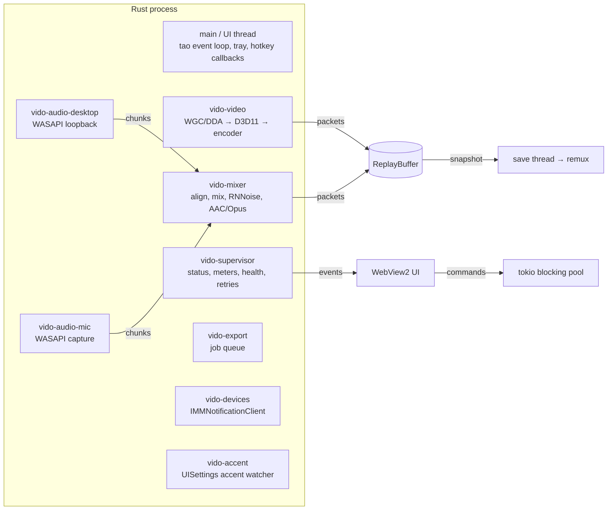

# Vido architecture

Vido is split into a **control panel** (React/TypeScript in a WebView2 window) and a **capture
engine** (Rust, inside the Tauri process). The UI only sends typed commands and renders typed events;
all capture, audio, encoding, file IO, hotkeys and tray work happen in Rust.

## Threads

- The **main thread stays STA** (the window library initializes OLE there). Every worker that uses
  COM/WinRT joins the MTA via `win::enter_mta()`, which also pins the MTA for the process lifetime
  (`CoIncrementMTAUsage`) because windows-rs caches activation factories in statics.
- The Recycle Bin call (`win::recycle_file`, `SHFileOperationW`) runs on its own short-lived STA
  thread, so it neither depends on nor changes the caller's apartment.
- Long work never runs on the UI thread: commands use `spawn_blocking`, saves/exports run on their
  own threads, and all results are reported through events.

## The capture session

`engine::Engine` owns at most one `Session` = video pipeline + audio engine + a buffer **epoch**.

1. `resolve_target` turns settings into a concrete display/window/region (`capture::enumerate`).
2. `AudioEngine::start` opens encoders (mix track + one per source) and starts one WASAPI thread
   per source. Sources are the devices ticked on the Audio page (up to 16): every output device
   via loopback and every input device, each `(direction, device)` at most once; "Windows
   default" entries (`deviceId: null`) follow the default device.
3. `VideoPipeline::start` creates a D3D11 device on the adapter that drives the target display,
   opens WGC (or DDA), picks the output size and opens the best encoder:
   - hardware encoders that accept D3D11 frames (NVENC, AMF) get textures from an FFmpeg
     `AVHWFramesContext` (individual NV12 render targets) → **zero copies**;
   - QSV/CPU encoders get NV12/YUV420P system frames via a staging read-back.
4. `ReplayBuffer::begin_epoch` gets the stream list (codec parameters incl. extradata, time bases,
   titles); then both pipelines receive `go()` and start pushing packets.

Changing capture/encoder/audio-format settings or the set of ticked audio devices (or a ticked
track's name) restarts the session (new epoch). Volume, mute, gain, mono and noise suppression
are applied live; buffer length/size limits too. Unticked devices keep their track settings
(disabled) so ticking them again restores them.

### Timing model

`buffer::clock::SessionClock` maps QPC timestamps (100 ns) to **media time** = time since start
minus pauses. Video frame _n_ has `pts = n` in time base `1/fps` and is encoded at media time
`n/fps` (high-resolution waitable timer); if the thread falls behind, indices are skipped and
counted as dropped. Audio packets are placed at `sample = round(media_time × rate)`. Both streams
therefore share one timeline and stay in sync across pauses.

### Replay buffer

`buffer::ReplayBuffer` stores encoded packets with metadata (`pts`, `dts`, key flag, media time).
Packets are grouped into segments that start at a video keyframe (target ≈2 s, keyframe interval
1 s by default). Payloads live in RAM (`Bytes`) or in one file per segment under the cache folder.

- **Eviction:** drop the oldest segment while the remaining ones still cover the target duration
  (+ one keyframe interval), or while total bytes exceed the cap.
- **Snapshot:** seals the open segment and clones the segment list (`Arc`s). Disk segment files are
  deleted on `Drop` of the last `Arc`, so eviction never pulls data out from under a save.
- **Start selection:** the latest keyframe at/before `end − N`, else the earliest keyframe. Save clip
  uses N = the buffer length, so a clip is the whole buffer without the eviction margin.
- **Taps:** manual recording registers a channel that receives every new packet; the initial
  snapshot and the tap are created under the same lock, so nothing is duplicated or lost.

`export::remux::write_snapshot` rebases timestamps so the first keyframe is at 0, writes to
`<name>.partial`, then renames. MP4 is written with `+faststart`.

## Export pipeline

`export::plan` validates an `ExportRequest` against the probed input and decides per stream:

| Situation                                               | Video                          | Audio                          |
| ------------------------------------------------------- | ------------------------------ | ------------------------------ |
| Trim only, compatible container, stream copy on         | **copy** from keyframe ≤ start | copy                           |
| Crop / scale / speed / fps / target size / codec change | encode (exact start)           | copy if unchanged, else encode |
| Track volume/mute/fades, or mixing tracks               | —                              | encode that output track       |

`export::transcode::run` performs one demux pass; copied streams are rebased, encoded streams go
decoder → libavfilter graph (`trim`, `crop`, `scale`, `setpts` for speed, `fps`, `format`;
`atrim`, `volume`, `amix`, `atempo` chain, `afade`, `aresample`, `aformat`) → encoder → muxer.
Target-size mode computes the video bitrate from the duration and audio bitrates
(`export::bitrate`), and `export::manager` re-encodes once or twice with a corrected bitrate if the
result overshoots by more than 1 %.

The editor's **Save** / **Save & override** (`export::edit`) reuse the same planner and job queue.
`save_request` pins the output to the source (native size, source fps and codec, quality mode,
stream copy when the planner allows it). Save writes `<stem>_edit.<ext>`. Override exports to a
hidden `<stem>.vido-tmp.<ext>` next to the original and only after success: recycles the original
(retrying while the file is busy), renames the temp to the original name, and restores the
original's modification time. Any failure before the rename leaves the original untouched and
removes the temp; a failed final rename keeps the temp and reports its path.

## Appearance

`theme.rs` decides Mica support (Windows build ≥ 22000) and watches the Windows accent palette
(`UISettings.ColorValuesChanged`, on an MTA worker). Each window's init script carries `mica` and
the palette, so the first paint already has the right colors; `accent-changed` updates them live.
Windows have no fixed theme: the title bar, Mica tint and the webview's `prefers-color-scheme`
follow the Windows app mode. CSS defines dark tokens in `:root` and light ones under
`prefers-color-scheme: light`; `.theme-dark` re-applies the dark set to surfaces drawn over video.

## IPC contract

Rust types are the source of truth; `ts-rs` generates `src/lib/tauri/bindings/*.ts` (`pnpm
bindings`). `src/lib/tauri/commands.ts` wraps every command with typed arguments/results and
`src/lib/tauri/events.ts` maps event names to payload types.

**Commands** (all validate their input in Rust and return `AppError { code, message, field?, hint? }`):

| Area         | Commands                                                                                                                                               |
| ------------ | ------------------------------------------------------------------------------------------------------------------------------------------------------ |
| App/settings | `get_app_info`, `get_settings`, `get_default_settings`, `update_settings`, `reset_settings`, `complete_first_run`                                      |
| Devices      | `list_displays`, `list_windows`, `list_audio_devices`, `get_encoder_capabilities`                                                                      |
| Buffer       | `start_buffer`, `stop_buffer`, `pause_buffer`, `resume_buffer`, `get_buffer_status`, `save_clip`, `toggle_recording`, `set_meters_enabled`             |
| Clips        | `list_clips`, `get_clip_details`, `delete_clip`, `reveal_clip`, `open_clip_external`, `copy_clip_path`, `get_waveform`, `take_screenshot`              |
| Export       | `estimate_export`, `export_clip`, `cancel_export`                                                                                                      |
| Windows      | `open_editor`, `show_main_window`, `pick_folder`, `pick_export_path`, `open_folder`, `open_region_picker`, `close_region_picker`, `set_capture_region` |
| Hotkeys      | `get_hotkey_status`, `set_hotkeys_suspended`                                                                                                           |

**Events:** `buffer-status`, `capture-error` (capture/audio/save problems with severity + hint),
`audio-devices-changed`, `audio-levels`, `export-progress`, `export-completed`, `export-failed`,
`hotkey-triggered`, `clip-saved`, `clips-changed`, `settings-changed`, `editor-open`, `hud-toast`,
`navigate`.

## Error handling & resilience

- Every FFmpeg/COM/IO failure becomes an `AppError` with a code the UI can act on.
- Capture and mixer threads run inside `catch_unwind`; a panic stops the session and is reported,
  never crashing the app. Panics are logged by a global hook.
- Lost window/display → session stops, buffered material stays saveable, the supervisor retries
  every 3 s and resumes automatically when the source returns.
- Lost audio device → that track records silence and reconnects when the device returns (or when
  the Windows default changes, for tracks that follow the default). Each source has its own
  thread and retry loop, so one failing device never stops the other tracks or the buffer.
- Black-frame detector (3×3 patch sampling every 2 s) warns after 6 s of black.
- Encoder fallback chain: chosen vendor → CPU; D3D11 input → system-memory input.
- Settings: validated on every update (field-level errors), repaired per section on load,
  written atomically (temp file + rename).

## Security notes

- Capabilities only grant core window/event permissions to Vido's own windows; everything
  else goes through app commands with Rust-side validation.
- Paths from the UI are checked: deletions are restricted to media files inside the clips folder;
  read-only operations require existing media files; export outputs must be absolute with the
  right extension and must not overwrite the input.
- The asset protocol (for `<video>` and thumbnails) is scoped at runtime to the clips folder, the
  thumbnail cache and individually opened files.
- CSP restricts scripts to the bundled app; no remote content is loaded.
- The only command that executes programs is the user-configured post-save command.

## Porting to Linux later

Platform code is isolated: `capture::{d3d, convert, wgc, dda, enumerate, pipeline}`,
`audio::{wasapi, engine}` and `win.rs` are `#[cfg(windows)]`. A Linux port would add a PipeWire
screencast source + VA-API/NVENC hw frames, a PipeWire/PulseAudio source behind the same
`AudioChunk` interface, and reuse the buffer, encoder, export, settings and UI layers unchanged.
